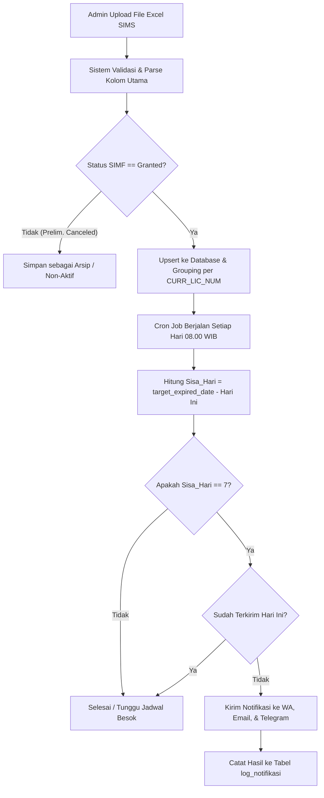

# Product Requirements Document — ISR Alert & Reminder System (SI-ISR)

**Document Version:** 1.0  
**Application Version:** MVP (v0.1)  
**Status:** Draft  
**Last Updated:** 20 November 2026  

---

## 1. Document Information

| Atribut | Detail |
| :--- | :--- |
| **Product Name** | Sistem Informasi Pengingat Masa Berlaku ISR (SI-ISR) |
| **Product Type** | Web-Based Internal Monitoring & Multi-Channel Notification System |
| **Primary Platform** | Web Application (Desktop & Mobile Browser Responsive) + Background Cron Scheduler |
| **Target MVP Version** | v0.1 |
| **PRD Status** | Draft (Siap Implementasi) |

---

## 2. Problem Background

* **Inti Permasalahan:** Data perizinan stasiun radio (hasil ekspor laporan SIMS/Postel) saat ini dikelola dalam file spreadsheet statis (`.xlsx`) dengan ribuan baris data perangkat/frekuensi. Pengecekan tanggal berakhir masa laku ISR masih dilakukan secara manual, sehingga berisiko tinggi melewatkan stasiun yang hampir habis masa berlakunya.
* **Persona Terdampak:** Tim Monitoring & Penertiban Spektrum Frekuensi Radio serta Tim Pelayanan Publik / Perizinan.
* **Proses Manual Saat Ini:** Petugas harus membuka file laporan Excel, melakukan filter manual pada kolom tanggal jatuh tempo (`MASA_LAKU` / `VALIDITY_DATE`), lalu mencari kontak pemegang izin dan menghubungi satu per satu secara manual.
* **Dampak Jika Tidak Ditangani:** Pemegang ISR terlambat melakukan perpanjangan atau pembayaran BHP Frekuensi tahunan, yang berujung pada status stasiun menjadi ilegal/tidak berizin, denda administratif, hingga beban kerja penertiban lapangan yang seharusnya dapat dicegah secara preventif.

---

## 3. Product Goals & Success Indicators

| Goal ID | Objective | Success Indicator | Target | Measurement Method |
| :--- | :--- | :--- | :--- | :--- |
| **GL-01** | Mengotomatiskan deteksi ISR yang akan jatuh tempo dalam waktu 7 hari (H-7). | Persentase data ISR aktif yang dipindai otomatis setiap hari oleh sistem. | 100% data ISR berstatus `Granted` terpantau harian. | Log eksekusi harian *Cron Job* sistem. |
| **GL-02** | Mempercepat penyampaian peringatan dini ke pemegang izin dan tim internal. | Ketepatan waktu pengiriman notifikasi pada H-7 sebelum masa berlaku habis. | Terkirim otomatis pada pukul 08.00 WIB tepat di H-7. | Audit trail pada tabel `log_notifikasi` (WhatsApp, Email, Telegram). |
| **GL-03** | Mengurangi risiko pengiriman spam akibat duplikasi baris perangkat pada file ekspor SIMS. | Satu nomor ISR (`CURR_LIC_NUM`) yang jatuh tempo pada tanggal sama hanya memicu 1 notifikasi per channel. | 0 pengiriman duplikat pada hari yang sama untuk nomor ISR yang sama. | Validasi unik kombinasi `curr_lic_num` + `tanggal_kirim` + `channel`. |
| **GL-04** | Menyediakan kemudahan pembaruan data dari file ekspor SIMS (`.xlsx`/`.csv`). | Waktu yang dibutuhkan admin untuk memperbarui database ISR bulanan. | Kurang dari 3 menit per sekali unggah file Excel. | Pengujian performa fitur *Import & Upsert* file laporan. |

---

## 4. Target Users & Roles

1. **Admin Sistem / Koordinator Tim (Primary User)**
   * **Peran:** Mengelola master data ISR (unggah file ekspor Postel/SIMS), melengkapi data kontak PIC (Email, WhatsApp, Telegram Chat ID) yang belum tersedia di file ekspor, mengatur konfigurasi API Gateway, dan memantau log pengiriman.
   * **Hambatan Utama:** File ekspor SIMS tidak memuat kolom alamat email dan nomor telepon PIC lapangan sering kali masih berupa nomor kantor pusat.
2. **Operator / Petugas Pelayanan & Monitoring (Secondary User)**
   * **Peran:** Memantau daftar stasiun yang masuk status kritis (H-7 s.d. Expired), mencatat tindak lanjut (*follow-up*) dari pemegang izin, dan menerima rekap harian melalui grup Telegram internal.
   * **Hambatan Utama:** Sulit melacak stasiun mana saja yang sudah dihubungi dan mana yang belum merespons.

---

## 5. Business Logic & Rules

### BL-01: Seleksi Data ISR Aktif (Eligibility Filter)
* **Trigger:** Proses import file Excel/CSV atau pemindaian harian (*Cron Job*).
* **Input:** Kolom `STATUS_SIMF`, `CURR_LIC_NUM`, `MASA_LAKU`, dan `VALIDITY_DATE`.
* **Processing:** Sistem hanya memproses dan mengaktifkan notifikasi untuk baris data dengan `STATUS_SIMF` bernilai `Granted` atau `Granted (Under modification)`. Baris dengan status `Prelim. Canceled` diabaikan dari antrean notifikasi.
* **Expected Output:** Hanya izin aktif yang masuk ke daftar pemantauan pengingat.
* **Constraints & Exceptions:** Jika satu nomor izin (`CURR_LIC_NUM`) muncul dalam beberapa baris (misalnya karena memiliki TX dan RX atau beberapa perangkat dalam satu izin), sistem mengelompokkan (*grouping*) berdasarkan `CURR_LIC_NUM` dan tanggal jatuh tempo agar tidak mengirim banyak pesan untuk satu nomor ISR yang sama.

### BL-02: Penentuan Tanggal Jatuh Tempo (Target Expiration Date)
* **Trigger:** Pemindaian harian pada pukul 08.00 WIB.
* **Input:** Kolom `MASA_LAKU` (tanggal jatuh tempo tahunan/BHP) dan `VALIDITY_DATE` (tanggal berakhir masa laku izin 5 tahunan), serta `CURRENT_DATE` (tanggal server hari ini).
* **Formula / Processing:**
  * `[Proposed Assumption]` Karena pada laporan Postel/SIMS terdapat dua tanggal penting—`MASA_LAKU` (jatuh tempo pembayaran tahunan/masa laku berjalan) dan `VALIDITY_DATE` (akhir masa berlaku siklus izin)—sistem menggunakan tanggal terdekat yang masih aktif sebagai `target_expired_date` (default: memprioritaskan `MASA_LAKU` jika terisi, atau `VALIDITY_DATE` jika `MASA_LAKU` kosong).
  * Hitung selisih hari: `Sisa_Hari = target_expired_date - CURRENT_DATE`.
* **Contoh Perhitungan:**
  * Jika `target_expired_date` = `27-NOV-2026` dan `CURRENT_DATE` = `20-NOV-2026`, maka `Sisa_Hari = 7`. Kondisi **H-7 terpenuhi**.
* **Constraints:** Baris dengan `MASA_LAKU` dan `VALIDITY_DATE` keduanya kosong (`NULL`) ditandai dengan status `Data Tanggal Tidak Lengkap` pada dashboard dan tidak dikirimkan notifikasi otomatis.

### BL-03: Aturan Pengiriman Multi-Channel pada H-7 (Idempotency & Routing)
* **Trigger:** `Sisa_Hari == 7` pada eksekusi *Cron Job* harian.
* **Input:** Data ISR terpilih, data kontak pada tabel `kontak_pic` / `clients` (`phone_wa`, `email`, `telegram_chat_id`), dan log pengiriman.
* **Processing:**
  1. Cek tabel `log_notifikasi`: apakah sudah ada catatan pengiriman sukses untuk `curr_lic_num` + `target_expired_date` + `channel` tersebut? Jika **Sudah Ada**, lewati (mencegah pengiriman ganda).
  2. **Channel WhatsApp & Email:** Dikirimkan ke kontak PIC pemegang izin (`CLNT_NAME`) jika nomor WhatsApp / alamat Email tersedia dan valid.
  3. **Channel Telegram:** Dikirimkan ke **Grup Telegram Internal Kantor** (berisi rekap daftar seluruh ISR yang hari ini menyentuh H-7) serta ke `telegram_chat_id` PIC eksternal jika terdaftar.
* **Expected Output:** Pesan terkirim sesuai template masing-masing channel dan tercatat di `log_notifikasi` dengan status `SUCCESS` atau `FAILED` (beserta pesan error dari API).

### BL-04: Normalisasi Nomor Telepon WhatsApp
* **Trigger:** Saat menyimpan/mengimpor kolom `PHONE` dari Excel atau input manual PIC.
* **Input:** String nomor telepon mentah (contoh dari file: `021-5215445`, `021 - 5761881`, `0812xxxx`).
* **Processing:**
  * Hapus seluruh karakter non-numerik (spasi, tanda hubung `-`, tanda kurung).
  * Jika diawali angka `0`, ubah awalan `0` menjadi kode negara `62` (contoh: `08123456789` $\rightarrow$ `628123456789`).
  * `[Proposed Assumption]` Nomor telepon rumah/kantor dengan kode area (seperti `021...`) ditandai sebagai `Telepon Kantor (Non-WA)` sehingga sistem tidak gagal berulang kali saat menembak API WhatsApp, kecuali admin telah mengisi nomor HP/WA PIC pada profil klien.

### BL-05: Status Tindak Lanjut (Follow-Up Lifecycle)
* **Trigger:** Perubahan status manual oleh Operator/Admin pada dashboard atau hasil sinkronisasi file SIMS terbaru.
* **State Transitions:**
  * `Active (Aman)` $\rightarrow$ `Warning H-7` (Otomatis saat `Sisa_Hari <= 7` dan `> 0`)
  * `Warning H-7` $\rightarrow$ `Expired` (Otomatis saat `Sisa_Hari <= 0`)
  * `Warning H-7` / `Expired` $\rightarrow$ `In Renewal` (Diubah manual oleh Operator saat PIC mengonfirmasi sedang mengurus perpanjangan)
  * `Warning H-7` / `In Renewal` $\rightarrow$ `Active (Aman)` (Otomatis saat file SIMS baru diunggah dan `target_expired_date` diperbarui ke tahun berikutnya).

---

## 6. Feature Requirements

| Feature Code | Feature Name | Requirement Description | Related Business Logic | Priority | Target Version |
| :--- | :--- | :--- | :--- | :--- | :--- |
| **FT-01** | **Import & Upsert Laporan SIMS (`.xlsx`/`.csv`)** | Admin dapat mengunggah file laporan Postel/SIMS (format 92 kolom standar). Sistem membaca kolom kunci (`CLNT_ID`, `NO_SIMF`, `CURR_LIC_NUM`, `CLNT_NAME`, `STATUS_SIMF`, `SERVICE`, `FREQ`, `STN_NAME`, `CITY`, `PROVINCE`, `MASA_LAKU`, `VALIDITY_DATE`, `PHONE`) dan melakukan *Insert* untuk data baru atau *Update* untuk `CURR_LIC_NUM` yang sudah ada. | BL-01, BL-02, BL-04 | **Must** | MVP v0.1 |
| **FT-02** | **Manajemen Direktori Klien & Kontak PIC** | Halaman untuk mengelola profil pemegang izin (`CLNT_NAME` / `CLNT_ID`) sehingga admin dapat menambahkan/mengedit **Nomor WhatsApp PIC**, **Alamat Email PIC**, dan **Telegram Chat ID** yang berlaku untuk seluruh stasiun milik klien tersebut. | BL-03, BL-04 | **Must** | MVP v0.1 |
| **FT-03** | **Scheduler Otomatis H-7 (Cron Engine)** | Skrip latar belakang yang berjalan otomatis setiap hari pukul 08.00 WIB untuk mengecek seluruh ISR yang tepat berada pada H-7 sebelum jatuh tempo dan memicu antrean pengiriman notifikasi. | BL-01, BL-02, BL-03 | **Must** | MVP v0.1 |
| **FT-04** | **Multi-Channel Notification Dispatcher** | Modul pengiriman pesan otomatis ke 3 kanal: **WhatsApp** (via WA Gateway API), **Email** (via SMTP/API dengan format surat pengingat resmi), dan **Telegram** (via Bot API untuk rekap grup internal & PIC). | BL-03 | **Must** | MVP v0.1 |
| **FT-05** | **Dashboard Monitoring & Filter Status** | Halaman utama yang menampilkan kartu ringkasan jumlah ISR (Total Aktif, Jatuh Tempo H-7 Hari Ini, Kritis $\le$ 7 Hari, Expired), dilengkapi tabel pencarian berdasarkan Nama Perusahaan, Nomor ISR, Frekuensi, dan Kabupaten/Kota. | BL-02, BL-05 | **Must** | MVP v0.1 |
| **FT-06** | **Manajemen Template Pesan & Pengaturan API** | Halaman konfigurasi bagi Admin untuk mengisi kredensial API (Token WA Gateway, SMTP Host/User/Pass, Telegram Bot Token & Group ID) serta mengedit template teks notifikasi dengan variabel dinamis (`{nama_klien}`, `{no_isr}`, `{frekuensi}`, `{lokasi_stasiun}`, `{tgl_jatuh_tempo}`). | BL-03 | **Must** | MVP v0.1 |
| **FT-07** | **Audit Log & Tombol Kirim Ulang Manual** | Riwayat status pengiriman setiap notifikasi (Waktu, Channel, Tujuan, Status Sukses/Gagal, Respons Error) disertai tombol **Kirim Ulang (Resend)** apabila pengiriman sebelumnya gagal karena gangguan jaringan/API. | BL-03 | **Should** | MVP v0.1 |
| **FT-08** | **Update Status Tindak Lanjut & Catatan** | Operator dapat mengubah status penanganan ISR (misal: *Dalam Proses Perpanjangan* atau *Tidak Diperpanjang*) dan menambahkan catatan hasil komunikasi dengan PIC. | BL-05 | **Should** | MVP v0.1 |

---

## 7. Main User Flow

### Alur 1: Pembaruan Data & Pengecekan Otomatis H-7

---

## 8. Acceptance Criteria

| AC ID | Related Feature | Condition (Given) | Event (When) | Expected Behavior (Then) | Pass Criteria |
| :--- | :--- | :--- | :--- | :--- | :--- |
| **AC-01** | FT-01 | Admin memiliki file Excel laporan Postel standar (`.xlsx`). | Admin mengunggah file tersebut pada menu Import Data. | Sistem memproses seluruh baris, mengabaikan yang berstatus `Prelim. Canceled` dari antrean alarm, dan menyimpan data `Granted` tanpa duplikasi `CURR_LIC_NUM`. | Jumlah record aktif sesuai dengan jumlah unik `CURR_LIC_NUM` berstatus `Granted` pada file. |
| **AC-02** | FT-02 | Sebuah perusahaan (misal PT. X) memiliki 500 stasiun radio dalam database. | Admin mengisi Email dan Nomor WhatsApp PIC pada master data klien PT. X. | Seluruh 500 stasiun milik PT. X otomatis terhubung dengan kontak PIC tersebut tanpa perlu diinput satu per satu. | Detail stasiun milik PT. X menampilkan Email dan No. WA PIC yang baru disimpan. |
| **AC-03** | FT-03, FT-04 | Terdapat 3 ISR aktif dengan `MASA_LAKU` tepat 7 hari dari tanggal hari ini, dan data kontak WA, Email, serta Telegram sudah terisi. | *Cron Job* harian dijalankan pada pukul 08.00 WIB. | Sistem mengirimkan 3 notifikasi ke WhatsApp PIC, 3 email pengingat ke Email PIC, dan 1 pesan rekap berisi 3 daftar ISR ke Grup Telegram internal. | Seluruh pesan diterima di perangkat tujuan dan tercatat `SUCCESS` di `log_notifikasi`. |
| **AC-04** | FT-03 | Notifikasi H-7 untuk ISR nomor `02973844-000SU/...` sudah sukses terkirim pukul 08.00 WIB. | Skrip *Cron Job* dijalankan ulang secara manual pada hari yang sama pukul 10.00 WIB. | Sistem mendeteksi log pengiriman hari ini sudah ada dan tidak mengirim pesan ulang. | Tidak ada pesan ganda yang masuk ke WhatsApp/Email/Telegram. |
| **AC-05** | FT-04, FT-07 | Data klien tidak memiliki nomor WhatsApp valid (hanya nomor telepon kantor `021-xxx` atau kosong). | *Cron Job* memproses ISR milik klien tersebut pada H-7. | Sistem melewati pengiriman WhatsApp (mencatat status `SKIPPED - No Valid WA`), tetapi tetap mengirimkan notifikasi ke Email dan Telegram. | Proses batch tidak berhenti/crash meskipun ada satu channel yang datanya kosong. |

---

## 9. Validation Test Scenarios

| Test ID | Related Req | Scenario | Test Input | Expected Result | Test Type |
| :--- | :--- | :--- | :--- | :--- | :--- |
| **TC-01** | FT-01, BL-01 | Import file laporan Postel dengan campuran status `Granted` dan `Prelim. Canceled`. | File `.xlsx` berisi 10 baris (`8 Granted`, `2 Prelim. Canceled`). | 8 data masuk ke daftar pantau aktif, 2 data tidak dijadwalkan untuk notifikasi. | Happy Path |
| **TC-02** | FT-03, BL-02 | Pengujian batas tepat H-7 vs H-8 dan H-6. | Tanggal sistem `20-NOV-2026`. ISR A jatuh tempo `27-NOV-2026` (H-7), ISR B `28-NOV-2026` (H-8), ISR C `26-NOV-2026` (H-6). | Hanya ISR A yang memicu pengiriman notifikasi otomatis H-7; ISR B dan C tidak dikirim. | Boundary |
| **TC-03** | FT-02, BL-04 | Normalisasi format nomor WhatsApp PIC. | Input nomor `0812-3456-7890` dan `021-5215445`. | `0812-3456-7890` tersimpan sebagai `6281234567890` (Valid WA); `021-5215445` ditandai sebagai nomor telepon tetap (Non-WA). | Boundary |
| **TC-04** | FT-04, FT-07 | Penanganan kegagalan koneksi API WhatsApp / SMTP. | Token WA Gateway diisi nilai tidak valid saat jadwal H-7 berjalan. | Sistem mencatat status `FAILED` beserta pesan error API pada `log_notifikasi`, dan notifikasi Telegram tetap terkirim. | Error |
| **TC-05** | FT-01 | Unggah ulang file Excel dengan tanggal `MASA_LAKU` yang sudah diperpanjang. | File `.xlsx` baru di mana `CURR_LIC_NUM` lama memiliki `MASA_LAKU` tahun depan. | Record lama diperbarui tanggalnya dan statusnya otomatis kembali menjadi `Active (Aman)`. | Happy Path |

---

## 10. Constraints & Out of Scope

### Business Constraints
* Pengiriman notifikasi otomatis dikunci secara default pada **H-7 (7 hari sebelum tanggal jatuh tempo)** agar tidak mengganggu pemegang izin dengan frekuensi pesan yang terlalu sering.
* Nada bahasa pesan pengingat ke pemegang izin harus bersifat **persuasif, informatif, dan resmi** (mengatasnamakan layanan informasi/monitoring frekuensi radio).

### Technical & Platform Constraints
* Aplikasi harus ringan dan dapat dijalankan di server standar kantor (misalnya PHP 8.x + MySQL/MariaDB) dengan dukungan *Cron Job* (Linux) atau *Task Scheduler* (Windows).
* Pengiriman WhatsApp dan Email bergantung pada ketersediaan layanan pihak ketiga (WA Gateway API / SMTP Server) yang dikonfigurasi oleh Admin.

### Explicit Out of Scope (Tidak Termasuk di MVP v0.1)
* **Integrasi API Langsung (Real-Time) ke Database Pusat SIMS:** Pada v0.1, sinkronisasi data dilakukan melalui unggah file ekspor Excel/CSV secara berkala, bukan koneksi database langsung ke server pusat.
* **Portal Pembayaran / Perpanjangan Mandiri oleh Pemegang Izin:** Pemegang izin tidak login ke aplikasi ini; proses perpanjangan tetap dilakukan melalui portal perizinan resmi pemerintah yang tautannya dicantumkan di dalam pesan notifikasi.
* **Notifikasi Multi-Tahap (H-90, H-60, H-30):** Sesuai kebutuhan saat ini, fokus utama MVP adalah pemicu tunggal tepat di **H-7**.

---

## 11. Data Entities & Storage Requirements

1. **`clients` (Master Pemegang Izin)**
   * `clnt_id` (Primary Key / Unique dari kolom `CLNT_ID`), `clnt_name` (Nama Perusahaan/Instansi), `corr_addr` (Alamat Korespondensi), `pic_name` (Nama PIC), `pic_wa` (Nomor WA terformat `628...`), `pic_email` (Email PIC), `pic_telegram_id` (Opsional).
2. **`isr_licenses` (Master Data Izin Stasiun Radio)**
   * `id`, `curr_lic_num` (Unique Nomor ISR, misal `02973844-000SU/2620252030`), `no_simf`, `clnt_id` (Relasi ke `clients`), `service` (Jenis Dinas, misal *Fixed Service*), `subservice`, `freq_mhz` (Ringkasan frekuensi), `stn_name` (Nama Stasiun), `city` (Kabupaten/Kota), `province`, `status_simf`, `licence_date`, `masa_laku` (Date), `validity_date` (Date), `followup_status` (`Active`, `Warning_H7`, `In_Renewal`, `Expired`), `operator_notes`.
3. **`notification_logs` (Riwayat Pengiriman)**
   * `id`, `isr_id` (Relasi ke `isr_licenses`), `target_date` (Tanggal jatuh tempo yang diperingatkan), `channel` (`WHATSAPP`, `EMAIL`, `TELEGRAM`), `recipient` (Nomor/Email/Chat ID tujuan), `message_body`, `status` (`SUCCESS`, `FAILED`, `SKIPPED`), `error_detail`, `sent_at` (Timestamp).
4. **`system_settings` (Konfigurasi Aplikasi & Template)**
   * `reminder_days_before` (Default: `7`), `cron_execution_time` (Default: `08:00`), `wa_api_url`, `wa_api_token`, `smtp_config`, `telegram_bot_token`, `telegram_internal_group_id`, `template_wa`, `template_email_subject`, `template_email_body`, `template_telegram`.

---

## 12. Assumptions, Risks & Open Items

* **Asumsi Data Kontak (`[Proposed Assumption]`):** Berdasarkan struktur laporan Postel standar, kolom `PHONE` umumnya berisi nomor telepon kantor pusat (seperti kode area `021-...`) dan belum memiliki kolom khusus `EMAIL` atau nomor HP WhatsApp PIC daerah. Oleh karena itu, disediakan menu **Direktori Klien & Kontak PIC** agar admin dapat melengkapi nomor WA dan email PIC sekali saja per perusahaan (`CLNT_ID`), yang otomatis berlaku untuk ratusan stasiun milik perusahaan tersebut.
* **Asumsi Kolom Tanggal Jatuh Tempo (`[Proposed Assumption]`):** File laporan memiliki kolom `MASA_LAKU` (jatuh tempo tahunan) dan `VALIDITY_DATE` (akhir masa izin). Sistem mengasumsikan `MASA_LAKU` sebagai acuan utama pengingat tahunan agar pemegang izin tidak terlambat membayar BHP tahunan.
* **Risiko Blokir Nomor WhatsApp:** Jika pada satu hari terdapat puluhan ISR milik perusahaan berbeda yang jatuh tempo bersamaan, pengiriman pesan WA secara serentak dalam hitungan milidetik berisiko memicu pembatasan (*rate-limit*) dari penyedia WA Gateway. **Mitigasi:** Tambahkan jeda acak (*random delay* 3–7 detik) antar pengiriman pesan WA dalam antrean *Cron Job*.

---

## 13. Requirement Traceability Matrix

| Business Logic (BL) | Feature Code (FT) | Acceptance Criteria (AC) | Test Case (TC) |
| :--- | :--- | :--- | :--- |
| **BL-01** (Seleksi Status `Granted` & Grouping `CURR_LIC_NUM`) | FT-01, FT-03 | AC-01 | TC-01 |
| **BL-02** (Perhitungan `Sisa_Hari == 7` dari `MASA_LAKU`) | FT-01, FT-03, FT-05 | AC-03 | TC-02 |
| **BL-03** (Idempotency / Anti-Duplikat & Routing 3 Channel) | FT-03, FT-04, FT-06, FT-07 | AC-03, AC-04, AC-05 | TC-04 |
| **BL-04** (Normalisasi Format Nomor Telepon ke `628...`) | FT-01, FT-02 | AC-02, AC-05 | TC-03 |
| **BL-05** (Siklus Status Tindak Lanjut & Reset saat Perpanjangan) | FT-05, FT-08 | AC-01 | TC-05 |